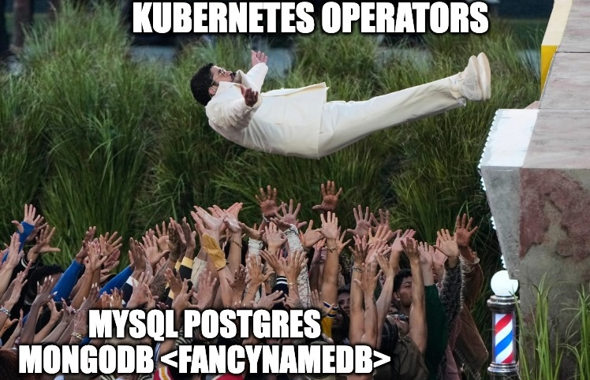
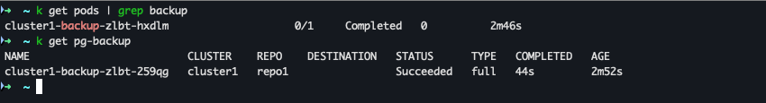

# Automated, Consistent, and Safe: Database Backups with Kubernetes Operators

**BuildDevCon 2026**

George Kechagias


---

## About Me


- **George Kechagias**
- Senior Software Engineer at **Percona**
- Working on the **Percona Kubernetes Operators**
- Based in Athens, Greece 🇬🇷

---

## Agenda

1. Why backups matter
2. What actually breaks in production
3. Challenges in containers
4. Backup tooling
5. Kubernetes Operators
6. Example Backups in K8s
7. Best practices
8. Q&A

---

## Why Backups Matter

- **Human error**: accidental `DELETE` without `WHERE`, dropped tables, bad migrations 💀
- **Infrastructure failures**: disk corruption, node crashes, cloud volume issues 💀 
- **Replication is not backup**: corrupted data replicates too 💀
- **Logical corruption**: bugs that silently write bad data, discovered days later 💀
- **Compliance**: regulations like GDPR require the ability to restore availability of personal data 💀

---

## What Actually Breaks in Production

- Backups succeed… but restores fail
- Failover during backup: the replica you're backing up gets promoted mid-backup
- Replication lag corrupts the backup
- Storage throttles or returns partial uploads
- Backup from a lagging replica: you think it's fresh, but it's missing recent transactions
- Nobody notices failures for weeks

> Can Kubernetes Operators help with that?

---

## Challenges: Backing Up Databases in Containers

- **Ephemeral environments**: pods reschedule, restart, and scale; backup jobs must tolerate this
- **Stateful data in a stateless world**: Persistent Volumes add complexity around mounting, locking, and snapshotting
- **Consistency & transaction safety**: naive filesystem snapshots can lead to corrupt backups; WAL, oplog, and binlog must be respected

---

## Challenges: Backing Up Databases in Containers (cont.)

- **Operational complexity**: ad-hoc CronJobs and scripts lead to snowflake configurations that are hard to audit
- **Multi-topology awareness**: primaries, replicas, sharded setups; backups must target the right instance without impacting performance
- **Observability**: hard to answer: are backups actually succeeding? Restore tests are rarely automated
- **Disaster recovery readiness**: backups without tested restore paths are unreliable

> Traditional backup approaches don't map cleanly to Kubernetes primitives.

---

## Backup Tooling 

| Tool | Database | Key Features |
|------|----------|--------------|
| [**Percona XtraBackup (PXB)**](https://docs.percona.com/percona-xtrabackup/8.0/index.html) | MySQL | Hot, non-blocking; full & incremental; compressed & encrypted; PITR; S3/GCS/Azure support |
| [**Percona Backup for MongoDB (PBM)**](https://docs.percona.com/percona-backup-mongodb/index.html) | MongoDB | Consistent sharded cluster & replica set backups; logical, physical & incremental; PITR; S3/GCS/Azure support |
| [**pgBackRest**](https://pgbackrest.org/) | PostgreSQL | Full, differential & block-level incremental; parallel backup & restore; encrypted repos; page checksum validation; S3/GCS/Azure support |

---
<!-- _header: "" -->
<!-- _footer: "" -->
<style scoped>section::before { display: none; }</style>




---

> PXB, PBM, and pgBackRest are what Percona Operators use under the hood.

---

## Some Kubernetes Operators😎

- **Percona Operator for MySQL (PXC)**: based on Percona XtraDB Cluster
- **Percona Operator for MySQL (PS)**: based on Percona Server for MySQL
- **Percona Operator for MongoDB (PSMDB)**: based on Percona Server for MongoDB
- **Percona Operator for PostgreSQL (PG)**: based on PostgreSQL with pgBackRest

Some features that are supported:
- Scheduled and on-demand backups
- Backup to S3-compatible storage
- Point-in-time recovery (PITR)

---

## How Operator Backups Work (Veeeery High Level)

1. User defines a `PerconaXtraDBClusterBackup` (or equivalent) CR
2. Operator orchestrates a backup
3. Data is streamed to object storage (S3, GCS, Azure)
4. Operator tracks backup status and metadata
5. Restore is triggered via a separate CR


---

## Under the Hood: PXB in the PXC Operator

**Two backup modes:**
- **Job-based** (default): operator creates a Kubernetes Job that runs `xtrabackup | xbcloud` — streams directly to object storage with no local staging
- **Sidecar** (alpha): a gRPC server runs alongside PXC pods; the operator calls `CreateBackup()` on the primary — avoids spinning up a separate pod

---

## Under the Hood: PXB in the PXC Operator (cont.)

**Key design considerations:**
- **Lease-based serialization**: a Kubernetes Lease (`<cluster>-backup-lease`) ensures only one backup runs at a time per cluster (opt-in parallel mode available)
- **State machine**: backup CR transitions through `New → Starting → Running → Succeeded/Failed`, with configurable deadlines at each stage
- **Streaming pipeline**: `xtrabackup → xbcloud` pipes data directly to S3/Azure/etc.
- **Cluster health gating**: backups are suspended if the cluster isn't `Ready`, preventing inconsistent snapshots
- **PITR**: a dedicated collector pod tails binlogs from the primary and uploads them to object storage, enabling point-in-time recovery between full backups

---

## Demo: MySQL (PXC) Backup

```yaml
apiVersion: pxc.percona.com/v1
kind: PerconaXtraDBClusterBackup
metadata:
  name: my-pxc-backup
spec:
  pxcCluster: my-cluster
  storageName: s3-storage
```

```bash
kubectl apply -f backup.yaml
kubectl get pxc-backup
```

---

## Demo: PostgreSQL Backup

```yaml
apiVersion: pgv2.percona.com/v2
kind: PerconaPGBackup
metadata:
  name: my-pg-backup
spec:
  pgCluster: my-postgresql
  repoName: repo1
```

```bash
kubectl apply -f backup.yaml
```



---

## Scheduling Backups

All three operators support cron-based schedules in the cluster CR:

```yaml
backup:
  schedule:
    - name: daily-backup
      schedule: "0 2 * * *"
      keep: 7
      storageName: s3-storage
```

- Runs automatically: no external cron needed
- Retention policies built in
- PITR can be enabled alongside scheduled backups

---

## Restoring from a Backup

```yaml
apiVersion: pxc.percona.com/v1
kind: PerconaXtraDBClusterRestore
metadata:
  name: my-restore
spec:
  pxcCluster: my-cluster
  backupName: my-pxc-backup
```

- Operator handles the full restore lifecycle
- Can restore to a **new cluster** or overwrite existing
- Point-in-time recovery available with PITR enabled

---

## Some... Backup Best Practices (Production-Grade)

- **Test restores regularly**: green backups ≠ usable backups; spin up a fresh cluster in a separate namespace to validate
- **Use operator-managed schedules**: let the operator handle retries, health checks, etc instead of ad-hoc CronJobs
- **Store credentials in Kubernetes Secrets**: don't hardcode S3 keys in backup CRs
- **Monitor backup CR status**: set up alerts on `Failed` states; don't assume greens
- **Version your CRs in Git**: treat backup and cluster definitions as IaC

> *No restores tested = no backups*


---
<!-- _header: "" -->
<!-- _footer: "" -->
<style scoped>section::before { display: none; }</style>


---

## What to Remember

1. **Backups are a first-class workload**, not an afterthought
2. **Kubernetes Operators make backups application/db-aware**
3. **Consistency FTW**: one CR model across databases
4. **If you don’t test restores, you don’t have backups**
5. **PITR is mandatory for real-world data safety**
6. **Backup configuration is part of your production API**

> Automate backups. Practice restores. Improve your sleep. Drink water.

---

## Q&A


**Resources:**
- [Percona Community Forum](https://forums.percona.com/)
- [Percona GitHub](https://github.com/percona)
- [Repository of this slides deck](https://github.com/gkech/builddevcon-2026-k8s-backups-slides)

